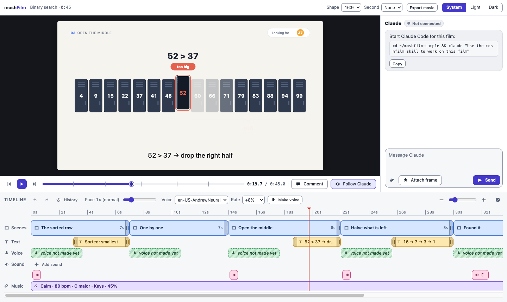

# moshFilm

moshFilm lets Claude Code build short motion-graphics films while you watch, adjust timing and leave comments in a
browser editor. You describe a topic or hand over a script or document; Claude proposes a scene list, you approve it,
and Claude builds the film scene by scene as small, deterministic HTML/SVG animations with a narrated voice track.
You drag scene lengths on a timeline, pin a comment to any frame, chat with Claude in a side panel, and export an MP4 or GIF.

## Features

- **Live chat with Claude Code**: a side panel with attachments, frame comments, and a working card that shows each step Claude takes.
- **Proposals you approve**: Claude proposes the scene list and every bigger change; your pinned values are never overwritten.
- **Shapes**: 16:9, 9:16, 1:1 or 4:5, plus an optional second shape on the same timeline and narration, with a layout check for each.
- **Export movie**: one button in the editor (or `moshfilm export`) renders an MP4 or GIF per shape.
- **Music and sound effects**: a generated music bed and 12 sound-effect presets, made locally, mixed under the narration.
- **Editing pack**: undo and redo with a history list, remove scenes, captions and voice lines, edit text in place.
- **Narration**: free Edge TTS voices with a fit check per line.



## Requirements

- Python 3.11 or newer
- ffmpeg (with ffprobe) for voice mixing and export
- Network access for the free Edge TTS voices (no API key, no paid account); see "Narration and privacy"
- Claude Code, to do the building

## Install

```sh
git clone https://github.com/moemenmostafa/moshfilm.git
cd moshfilm
scripts/setup.sh
```

The script creates `.venv`, installs moshFilm, downloads Chromium for export (about 150 MB, skipped when already
present) and checks for ffmpeg. Chromium is not stored in the checkout: Playwright keeps it in its own cache folder
(`~/Library/Caches/ms-playwright` on macOS, `~/.cache/ms-playwright` on Linux), shared with any other Playwright project. It is safe to run again. Anything outside the checkout is optional and asked first: putting `moshfilm` on
your PATH (a link in `~/.local/bin`) and linking the Claude Code skill into `~/.claude/skills/moshfilm`. Use `--path`,
`--skill`, `--yes` or their `--no-` forms to answer in advance, and `--dry-run` to see what would happen.

## Quick start

```sh
.venv/bin/moshfilm sample ~/moshfilm-sample
.venv/bin/moshfilm open ~/moshfilm-sample
```

`open` starts the editor on `127.0.0.1` (first free port from 5717 to 5727) and opens your browser.

The editor needs a current browser: Chrome 123, Safari 17.5 or Firefox 120 or newer (the light and dark themes use CSS `light-dark()`).

## Working with Claude Code

1. Start Claude Code in the film folder and say: "Use the moshfilm skill to work on this film".
2. Claude runs `moshfilm open`, keeps `moshfilm watch` running (the panel shows "Claude connected"), and listens.
3. Talk to Claude in the chat panel. For a new film, give a topic, a script, or upload a document: Claude proposes a
   scene list first and builds only after you approve it. Scenes go from planned to building to ready.
4. Pin a comment to a frame to change one detail of one scene; Claude replies and resolves it.
5. Watch Claude work: a card under the message shows a spinner, the elapsed time, a plan checklist and each step
   (tick when done, cross when it failed). When the turn ends it collapses to one line such as
   "Worked 1m 12s · 6 steps"; click it to expand. The preview and timeline update by themselves as Claude changes the
   film. With "Follow Claude" on (the default; remembered per film) the preview jumps to the scene being edited and
   plays it once after the change, but never moves while you are playing or scrubbing.
6. "📍 Attach frame" beside Send (off by default, remembered per film) sends the current playhead position with
   your message; it shows as a chip you can click to seek, and Claude gets it as `at`.

### Editing: undo, remove, edit text

- **Undo / redo**: the ↶ ↷ buttons above the timeline, or ⌘Z / ⇧⌘Z (Ctrl+Z / Ctrl+Shift+Z elsewhere; not while you type
  in a text box). Each edit you make is one step; one Claude turn is one step too ("Claude: edited scene 03"). The
  **History** list shows the last steps; click one to jump there. History lives in `<film>/.moshfilm/history/`
  (last 100 steps or 20 MB), survives a reload or restart, and covers `film.json`, pinned flags and scene files.
- **Remove**: click a scene, text clip, voice line or the music bar and press Delete/Backspace, or use the ✕ on the
  clip. Removing a scene asks first, closes the gap and takes its voice line and captions with it. Claude is told, and
  cannot bring it back without your approval.
- **Edit text**: double-click a voice line or a caption to type over it; Enter or clicking away saves, Esc cancels.
  A new voice line is made automatically and the fit check reruns (a scene that is too short turns red). Your words
  are pinned: Claude will not overwrite them unless you ask.

Undo covers `film.json` and the top-level `scenes/*.js` files only; other files are not snapshotted. Claude gets a
short chat note for every undo, redo, removal and text edit, and you get one if a change by Claude clears your redo steps.

### Music and sound

moshFilm composes its own audio, locally and for free: it is synthesised with numpy (a BSD-licensed Python library),
nothing is downloaded and no audio files or soundfonts ship with the code, so there is no licence to worry about.
The **Music** lane can generate a bed ("Generate music"): pick a mood (calm, bright, playful, tense, inspiring), tempo,
key, scale and instrument palette, or press "New variation" for another melody. It is exactly as long as the film,
ducks under the voice, fades out and loops cleanly; "Add music…" still takes a file of your own. The **Sound** lane
holds short effects (whoosh, swoosh-up, door, ding, pop, tick, click, success, error, typewriter, riser, thud): "Add
sound" puts one at the playhead, you can listen first, drag it (onto another scene too), turn it down or remove it, and
undo any of it. Claude can propose music and sounds as well, but never replaces what you picked. Sounds follow their
scene when it moves or changes length. Preview and export play the same mix, and export mixes voice, music and sounds
into every shape. `moshfilm sounds` lists the presets; `moshfilm check` warns about sounds over the narration, too
close together or too many in a scene. Generated audio is cached in `<film>/.moshfilm/sound/`.

### Activity hooks

The working card is fed by Claude Code hooks. `moshfilm new` and `moshfilm sample` install them into
`<folder>/.claude/settings.local.json` (pass `--no-hooks` to skip); nothing outside the film folder is touched.
For a film that already exists run `moshfilm hooks install <folder>`; `--uninstall` removes only moshFilm's entries.
A Claude Code session reads its hooks when it starts, so **restart the session** (start `claude` again in the film
folder) after installing. The hooks run `python -m moshfilm.hook` (a lightweight twin of `moshfilm activity`), also for UserPromptSubmit so an interrupted turn is closed by the next prompt. It only records short step labels (never file contents or
command output), uses no network and always exits 0.

## How it works

A film is a folder:

| Path | Written by | What it is |
| --- | --- | --- |
| `film.json` | the editor and applied proposals | title, scenes, voice lines, text clips, pace, pinned flags, what you removed |
| `scenes/<id>.js` | Claude | one scene: an ES module with `setup(root, ctx)` and `render(t, ctx)` |
| `proposals.json` | `moshfilm propose` | Claude's requested changes and their state |
| `comments.json` | the editor and the `moshfilm` CLI | chat, frame comments, events and Claude's replies |
| `sources/`, `music/` | you | documents for Claude to read, an optional music file (a generated bed needs no file) |
| `.moshfilm/` | moshFilm | heartbeat, status, activity and plan, voice cache, undo history (safe to delete, but undo then starts over) |

Scenes are seekable and deterministic: `render` is a pure function of the time `t`, with no timers, clock or
`Math.random` (only the seeded `ctx.random`), so the preview and the export show the same frames.

Pinning: when you drag something on the timeline, it becomes pinned. Claude's proposals never overwrite pinned values;
they are held for you to approve.

Pacing: an unpinned scene is never shorter than its voice line plus a 0.8 s pause; a length you pinned wins, even if
the voice then overflows. Pace runs from 0.75 to 2.0 (above 1 is
slower, default 1.0). Narration may speed up by at most 1.25x to fit; if a line still does not fit, the editor says
"voice doesn't fit — stretch scene or shorten line" and export refuses until it is fixed. Default voice is
`en-US-AndrewNeural` at `+8%`.

Shapes: a film has a main shape (16:9, 9:16, 1:1 or 4:5) and optionally a second one that shares the same timeline and
narration (pick both in the timeline header; the preview has a switch between them, and a comment remembers the shape it
was made on). Scenes draw from `ctx.width` and `ctx.height`, so one scene fits every shape, and
`moshfilm check <folder> --layout` draws each scene in each shape and warns about anything that sticks out of the frame
or is clipped. Export writes one file per shape: with two shapes the names carry the shape (`binary-search-16x9.mp4`
and `binary-search-9x16.mp4`; with `-o out.mp4`, `out-16x9.mp4` and `out-9x16.mp4`).

## Command line

| Command | What it does |
| --- | --- |
| `moshfilm new <folder>` | create an empty film folder (`--no-hooks` skips the Claude Code hooks) |
| `moshfilm sample <folder>` | copy the bundled sample film (`--no-hooks` as above) |
| `moshfilm hooks install <folder>` | add the activity hooks to `.claude/settings.local.json` (`--uninstall` removes them) |
| `moshfilm plan <folder>` | `--set "step" ...`, `--done N`, `--clear`: the plan checklist in the panel |
| `moshfilm activity` | the hook itself: reads a Claude Code hook payload on stdin; not run by hand |
| `moshfilm open <folder>` | start the editor and open the browser |
| `moshfilm watch <folder>` | print chat, comments and events as JSON lines (`--once` for one batch) |
| `moshfilm propose <folder> <file>` | add a proposal from a JSON file, or `-` for stdin |
| `moshfilm reply <folder> <id> <text>` | answer an item and resolve it |
| `moshfilm say <folder> <text>` | send a chat message |
| `moshfilm status <folder> <text>` | set Claude's status line (`--clear` to remove) |
| `moshfilm resolve <folder> <id>` | mark an item resolved |
| `moshfilm check <folder>` | validate the folder and scan scenes for non-deterministic code (`--layout` also draws every scene in each shape and warns about overflow; `--aspect A` adds a shape) |
| `moshfilm voice <folder>` | make the narration and report how each line fits |
| `moshfilm export <folder>` | render MP4, one file per shape (`--format gif`, `-o`, `--fps`, `--width`, `--no-voice`) |

## Export

```sh
.venv/bin/moshfilm export ~/moshfilm-sample              # MP4
.venv/bin/moshfilm export ~/moshfilm-sample --format gif
```

Files land in the film's `exports/` folder unless you pass `-o`. The editor's **Export movie** button (top bar) writes to the same folder, one file per shape, with download links when it is done. Pass `--no-voice` to export without narration (and without the network).

## Narration and privacy

Narration uses the `edge-tts` package (LGPL-3.0, installed unchanged as a dependency), an unofficial client for
Microsoft's online Read Aloud service. Each voice line's text is sent to that Microsoft service to be turned into speech;
nothing else from your film leaves your machine. The service is not an official product API: Microsoft can change or
stop it at any time, and moshFilm is not endorsed by Microsoft. For fully offline use, export with
`moshfilm export <folder> --no-voice`: the film is rendered without narration and scene lengths stay as in the preview.
Voice lines already made are cached in `<film>/.moshfilm/` and are not requested again.

## Known limits

- Export is slow: it takes one Chromium screenshot per frame, so a 45 s film at 30 fps is about 1,350 screenshots
  and takes minutes, not seconds.
- Narration needs the network (see above); `--no-voice` skips it.
- "Show in folder" in the editor works on macOS only.
- Node 20.19+ (or 22.12+) is needed to develop the UI, because Vite 8 requires it. Using moshFilm does not need Node.
- More small items are listed in `docs/KNOWN_ISSUES.md`.

## Development

```sh
.venv/bin/pytest          # Python tests (slow ones skip when ffmpeg or Chromium is missing)
cd ui && npm install && npm test
```

Node 20.19+ is only needed to work on the UI; the built UI is committed under `src/moshfilm/static/`.

## Licence

MIT. See `LICENSE`. Copyright 2026 Moamen Mostafa.

## Credits

The Binary search sample is inspired by the ideas in *Grokking Algorithms* by Aditya Bhargava; its script and drawings are original.
